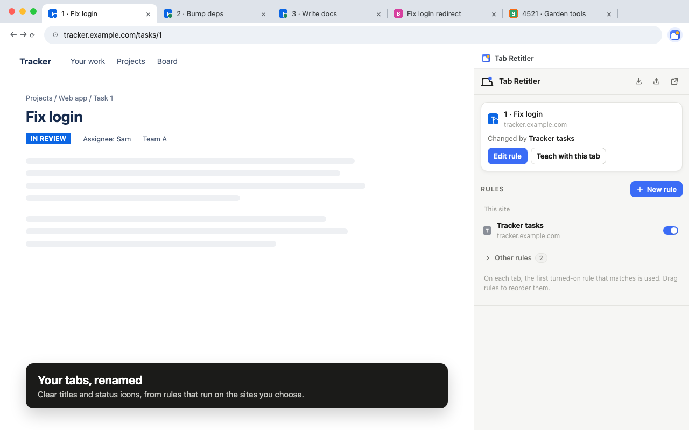

# Tab Retitler

A Chrome extension that renames tabs and badges their icons using rules based on each page's URL and content. You teach it by example, in Chrome's side panel, next to the page.



## What it does

- **Renames tabs** from parts of the address, the page title, or text on the page: `4521 · Garden tools` instead of `Shop – Product page`.
- **Learns rules from examples.** Type the title you want for a tab and it works out where each part comes from. Give it examples from more tabs and it keeps every rule that fits them all, narrowing down as you go and asking on your other open tabs when it's unsure. It also learns case changes and slugs, so `/posts/fix-login-redirect` can become `Fix login redirect`.
- **Changes icons:** a dot or short text badge (round, square or a corner flag, in any corner and size), an outline, or a tint, gray or fade. Icons can follow the page, like green when a task's status label says "Done", and it suggests colors from the page's own labels.
- **Edits next to the page.** The real tab is the preview: rules apply as you type, and the panel shows how a rule does on the tab you're looking at.
- **Shares rules** as a short code (`TR2:…`) or readable JSON, with a preview before importing.

Everything stays on your computer: no account, no analytics, and it only runs on sites you allow. See the [privacy policy](https://ignaciofh9.github.io/tab-retitler/privacy-policy.html).

## Install

From source:

1. Download or clone this repository.
2. Open `chrome://extensions` and turn on **Developer mode**.
3. Click **Load unpacked** and choose the `tab-retitler` folder.
4. Click the Tab Retitler toolbar button to open the side panel.

Needs Chrome 116 or later.

## Build

```sh
./build.sh
```

Makes `dist/tab-retitler-<version>.zip` for the Chrome Web Store: the `tab-retitler` folder without test-only files, checked so nothing it loads is missing.

To change the icons, edit the SVGs in `store-assets/src/` and run `store-assets/render-icons.sh` (macOS, needs Chrome).

## How it's put together

Plain JavaScript with no dependencies or build step. In `tab-retitler/`:

| File | What it does |
|---|---|
| `manifest.json` | Manifest V3. Site access is optional and requested one site at a time. |
| `background.js` | Registers the content script on allowed sites, and draws badged icons. |
| `content.js` | Runs in tabs: applies rules, and answers the panel (what a rule finds here, page text and colored labels for teaching). |
| `shared.js` | The rule engine: matching, value extraction, title templates, icon drawing, CSS selector generation. Used everywhere. |
| `infer.js` | Builds rules from examples: splits the wanted title into fixed text and values, finds where each value comes from, and keeps every rule that fits all examples. Also infers icons. |
| `share.js` | Share codes and JSON. Codes are a compact binary layout, deflated, with a checksum. |
| `options.html`, `options.js`, `options.css` | The editor, used both in the side panel and as a full page. |
| `picker.js` | Point-and-click element picker, injected into the page. |
| `preview-shim.js` | Testing only: lets `options.html` open as a plain web page. Left out of store builds. |

`store-assets/` has the Chrome Web Store listing text, screenshots and icon sources. `docs/` is the GitHub Pages site with the privacy policy.

## License

[MIT](LICENSE)
